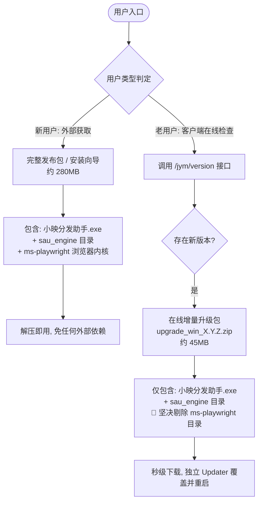
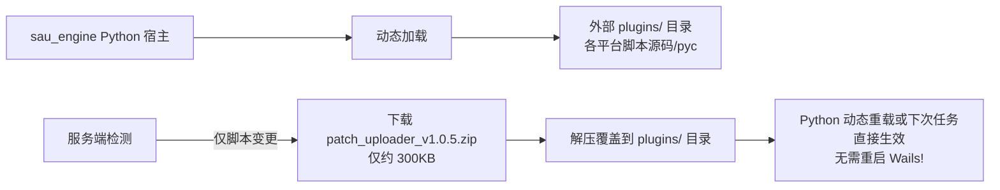
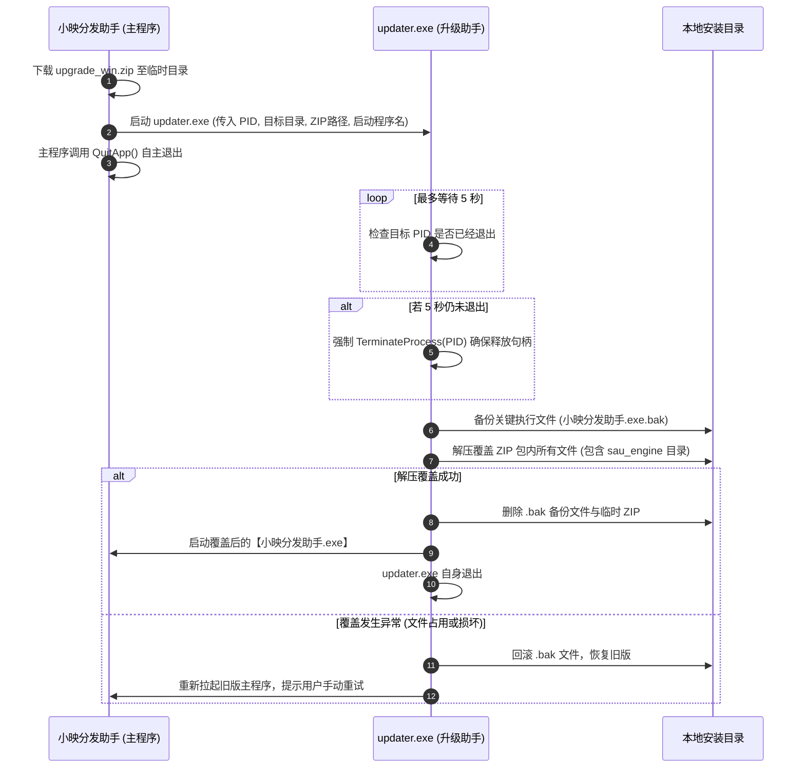
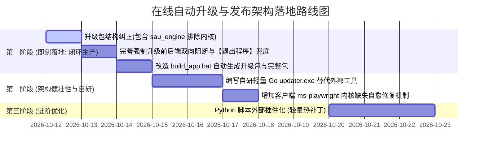

# 小映分发助手在线自动升级与发布架构优化方案

> **文档版本**：v1.0.0  
> **制定日期**：2026-10-12  
> **适用范围**：`sau_desktop` (Wails Go + Vue3 客户端) 与 `sau_engine` (Python 自动化发帖引擎)

---

## 目录

1. [背景与核心痛点分析](#一背景与核心痛点分析)
2. [新用户与老用户判定及交付分流](#二新用户与老用户判定及交付分流)
3. [双层架构版本与 Python 引擎热补丁方案](#三双层架构版本与-python-引擎热补丁方案)
4. [独立升级辅助工具 (Updater) 架构设计](#四独立升级辅助工具-updater-架构设计)
5. [强制升级全链路严格闭环方案](#五强制升级全链路严格闭环方案)
6. [打包工程化与发布流水线闭环](#六打包工程化与发布流水线闭环)
7. [分阶段实施路线图](#七分阶段实施路线图)

---

## 一、背景与核心痛点分析

本客户端采用 **“Wails 桌面外壳 (Go + Vue3) + Python 独立发布引擎 (sau_engine) + 内置 Chromium 浏览器内核 (ms-playwright)”** 的复合多进程架构。目前客户端已初步具备版本检测与下载覆盖的基础逻辑，但在**全流程闭环**与**实际生产运维**中存在以下 5 个核心痛点：

```mermaid
graph TD
    subgraph 现有产物结构 (build/bin)
        A[小映分发助手.exe<br>~35MB]
        B[sau_engine 目录<br>~50MB 核心业务发帖引擎]
        C[ms-playwright 目录<br>~200MB 浏览器内核]
    end
    
    A -. 仅替换该文件 .-> D[❌ 严重问题: 平台改版在 sau_engine 中, 界面升级了但发帖依旧报错!]
    A & B & C -. 全量压缩升级 .-> E[❌ 严重问题: 每次热更新需下载近 300MB, 用户更新极慢!]
```

1. **产物不单一，仅更新主程序无法解决业务改版**：社交平台（抖音、快手、小红书、视频号）网页改版频率高，业务核心与风控算法均在 `sau_engine/` 中。若热更新只替换 `.exe`，发帖修复根本无法生效。
2. **缺乏新老用户交付分流**：新用户需要“开箱即用”（必须带浏览器内核）；老用户只需要“增量热更”（不需要重复下载 200MB 的 Chromium）。
3. **缺少独立的 Python 脚本级热补丁机制**：目前每次 Python 代码微调都要整体重新打包 `sau_engine`。
4. **外部升级工具（uptool.exe）黑盒不可控**：借用外部工具可能存在参数不兼容、报错无法捕获、UI 标题不统一、进程锁死无法强制杀死等问题。
5. **强制升级（is_forced）未形成全链路死锁**：当前仅在前端弹窗层面阻止关闭，若用户打开了开发者模式或绕过弹窗，Go 后端未做 API 拦截，依然能继续发帖，未能实现真正的“不更新就不可用”。

---

## 二、新用户与老用户判定及交付分流

### 1. 新老用户的本质差异

| 维度 | 新用户 (First-time User) | 老用户 (Existing User) |
| :--- | :--- | :--- |
| **本地运行环境** | 电脑上从未运行过本程序，无配置文件、无平台 Cookie、**无本地 Chromium 内核** | 电脑上已正常使用，本地已完整部署 Chromium 内核及账号数据 |
| **获取渠道** | 官方网站、百度网盘、微信群或客服发送的安装包 | 已经在客户端内运行，触发后台或手动版本检测 |
| **期望体验** | 下载解压/安装后双击即用，**绝不能让用户自行配环境或再等 5 分钟下内核** | **升级包越小越好（<50MB）**，最好几秒钟下载完成，重启无感知 |

### 2. 交付与更新分流设计



### 3. 客户端自我诊断兜底（内核自愈机制）

针对老用户在线热更新后、或误删内核导致环境损坏的场景，在客户端启动时做**内核环境健康检查**：
* 若检测到 `ms-playwright` 缺失，则弹窗提示：“检测到浏览器组件损坏，正在自动为您智能修复补全...”，后台异步单拉内核包，无需强制用户重新下载整个 300MB 程序。

---

## 三、双层架构版本与 Python 引擎热补丁方案

为了平衡开发效率与上线频率，升级机制分为 **阶段一（增量整包，立竿见影）** 与 **阶段二（脚本热补丁，极致轻量）**：

### 阶段一：增量整包升级（当前推荐立即落地）

* **升级包结构**：
  ```text
  upgrade_win_1.3.0.zip (约 45MB ~ 50MB)
  ├── 小映分发助手.exe             (更新 Wails 桌面壳子与前端 UI)
  └── sau_engine/                 (全量覆盖更新 Python 核心引擎)
      ├── sau_engine.exe
      ├── _internal/
      └── uploader/
  ```
* **效果**：剔除了 200MB 的浏览器内核，体积从 300MB 骤降至 50MB，同时确保了前端界面与 Python 业务引擎的 100% 同步更新。

### 阶段二：Python 脚本插件化独立热补丁（进阶演进）

针对“小红书/抖音前端每天微调某个 CSS 选择器，只需修改几个 `.py` 文件”的场景：



* **实现方式**：
  1. 将经常变动的 `uploader/` 目录从 PyInstaller 的内部打包中解放出来，作为外部目录分发；
  2. 客户端版本分为 `AppVersion`（如 `1.3.0`）与 `EnginePatchVersion`（如 `20261012`）；
  3. 纯选择器改动只需推送轻量补丁包，用户在使用过程中无需重启即可完成修复。

---

## 四、独立升级辅助工具 (Updater) 架构设计

### 1. 为什么必须由独立进程执行？

在 Windows 操作系统中：
* 运行中的可执行文件（`.exe`）及其加载的动态链接库（`.dll`）会被系统赋予内核级排他文件锁（`ERROR_SHARING_VIOLATION`，错误码 32）。
* **进程无法在运行状态下替换自身**。
* 必须在主程序完全退出、释放所有句柄后，由第三方外部进程执行解压、覆盖、校验并重新拉起。

### 2. 自研专属升级工具 `updater.exe` 优势（对比外部 uptool.exe）

| 比较维度 | 外部 `uptool.exe` | 自研 `updater.exe` (Go 单文件，约 3MB) |
| :--- | :--- | :--- |
| **UI 与品牌** | 显示小映升级界面或控制台，文案无法深度定制 | 原生统一品牌风格，进度条与状态完全可控 |
| **进程防死锁** | 若主程序存在僵尸子进程，可能会覆盖失败卡死 | **主动通过 PID 监控并兜底 Force-Kill 主进程与残留 sau_engine** |
| **解压覆盖容错** | 覆盖失败时直接报错退出，导致程序损坏 | **支持先备份旧版本（.bak），解压失败自动回滚** |
| **执行权限** | 依赖复杂的 ShellExecute 提权配置 | 编译时内嵌 `requireAdministrator` 清单，直接具备管理员权限 |

### 3. Updater 升级生命周期状态机



---

## 五、强制升级全链路严格闭环方案

### 1. 接口协议字段语义定义

版本接口 `GET /jym/version?tool_id=4` 返回的核心控制字段：

```json
{
  "code": 200,
  "result": {
    "version": "1.3.0",
    "version_name": "1.3.0",
    "is_forced": 1,
    "is_pop_up": 1,
    "min_version": "1.2.0",
    "desc": "<p>【重要修复】由于抖音平台接口重大重构，旧版已无法发布，请务必升级后使用。</p>"
  }
}
```

* `is_forced = 1`：当前版本已被强制弃用，**不可绕过**。
* `is_pop_up = 1`：应用启动即弹出全屏/模态升级通知。
* `min_version`：最低兼容版本（低于此版本的强制拦截，高于但低于最新版的为建议更新）。

### 2. 前后端双重死锁闭环机制

```mermaid
flowchart TD
    Check[启动版本检测] --> IsForced{是否触发强制升级?}
    
    IsForced -->|否: 普通新版| Soft[非阻断通知 / 稍后提醒]
    
    IsForced -->|是: 强制升级| LockFront[前端锁定] & LockBack[Go 后端全局守卫开启]
    
    LockFront --> FrontUI["1. 模态框去除关闭按钮 (禁用 ESC, 禁用遮罩点击)<br>2. 仅保留【立即更新】与【退出程序】<br>3. 路由守卫阻断所有导航与跳转"]
    
    LockBack --> BackGuard["在 app.go 与 executor 中增加 VersionGate 拦截:<br>所有 ExecPublish / LoginAccount 请求直接熔断报错:<br>『当前客户端版本已停用，请更新至最新版本』"]
    
    FrontUI --> Action{用户操作}
    Action -->|点击立即更新| AutoUp[全自动下载 -> 自动调用 Updater -> 自动重启]
    Action -->|点击退出程序| Quit[调用 QuitApp() 彻底退出进程]
```

---

## 六、打包工程化与发布流水线闭环

更新 [build_app.bat](file:///Users/xiangmuzu3/Desktop/自动发布/social-auto-upload/build_app.bat)，实现一次打包，自动产出两套标准制品：

```text
根目录/dist_release/
├── 小映分发助手_v1.0.0_完整绿色版.zip   <-- 交付新用户 (约 280MB，含 ms-playwright 浏览器内核)
└── upgrade_win_1.0.0.zip              <-- 上传 OSS 供在线热更新 (约 45MB，排除 ms-playwright)
```

### `build_app.bat` 升级流水线设计：

```bat
:: [Step 5/5] 自动化制品归档与热更新包提炼
set "RELEASE_DIR=%PROJECT_ROOT%dist_release"
mkdir "%RELEASE_DIR%"

:: 1. 提炼在线热更新包 (排除内核，体积小)
echo 📦 正在生成在线增量热更新包 (upgrade_win_%APP_VER%.zip)...
powershell -Command "Compress-Archive -Path '%FINAL_BIN%\小映分发助手.exe', '%FINAL_BIN%\sau_engine' -DestinationPath '%RELEASE_DIR%\upgrade_win_%APP_VER%.zip' -Force"

:: 2. 生成全量绿色版安装包 (包含内核，新用户解压即用)
echo 📦 正在生成新用户完整开箱即用绿色包...
powershell -Command "Compress-Archive -Path '%FINAL_BIN%\*' -DestinationPath '%RELEASE_DIR%\小映分发助手_v%APP_VER%_完整绿色版.zip' -Force"
```

---

## 七、分阶段实施路线图



### 总结要点

1. **新用户给全包**（含浏览器，解压即用），**老用户给差量包**（含主程序 + `sau_engine`，不含浏览器，50MB 极速下载）。
2. **升级必须覆盖 `sau_engine` 目录**，否则任何发布平台的 Python 改版与修复都无法生效。
3. **强制更新必须双端死锁**：前端无关闭按钮、提供【退出程序】按钮；后端拦截发帖业务 API。
4. **升级工具必须独立进程运行**，后续采用轻量自研 Go 升级器提供完善的 PID 防锁死与回滚保护。
